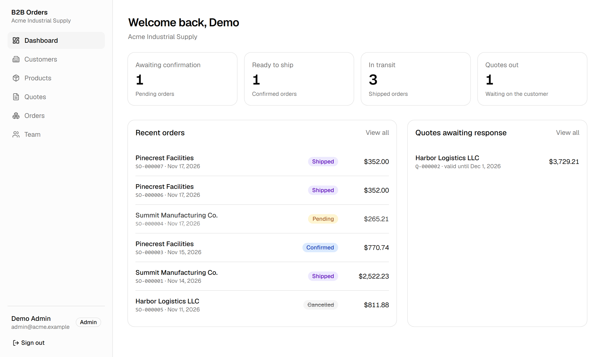
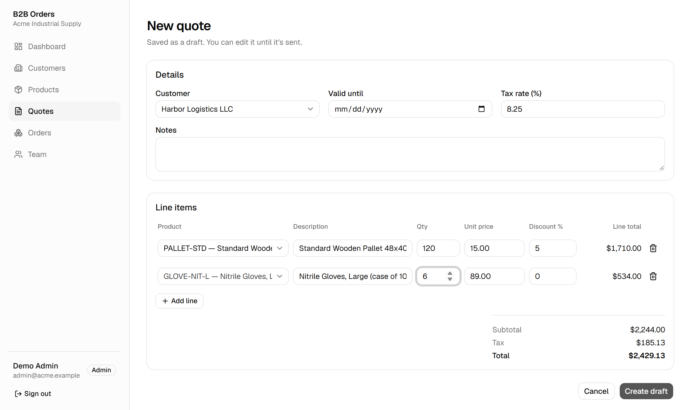
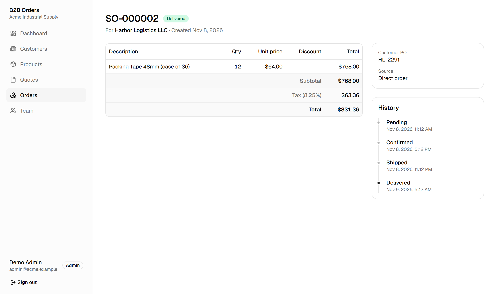

# B2B Order Management

[](https://github.com/antoinexu/b2b-order-management/actions/workflows/ci.yml)
[](LICENSE)

A full-stack, multi-tenant B2B order management app: customer management, product catalog, quotes with a full
approval lifecycle, quote-to-order conversion, order fulfilment tracking and role-based access control.

**API:** TypeScript · Node.js · Express 5 · PostgreSQL · Drizzle ORM · Zod · JWT · OpenAPI 3 · Vitest · Docker<br>
**Web:** React 19 · Vite · TanStack Query · React Router · Tailwind CSS · shadcn/ui · Playwright



| Quote editor with live pricing | Order detail with status history |
| --- | --- |
|  |  |

## Try it in 30 seconds

No database or Docker needed. The API can run on an in-memory Postgres preloaded with demo data:

```bash
npm install && npm --prefix web install
npm run dev:memory          # API on :3000 with demo data (in-memory, reset on restart)
npm --prefix web run dev    # web app on http://localhost:5173
```

Sign in with one click as **Admin**, **Manager**, **Sales** or **Viewer** to see how the UI adapts to each role.

## Features

- **Multi-tenancy:** each organization's data is fully isolated; cross-tenant access returns `404`.
- **Authentication:** register an organization, log in with email/password (scrypt hashes), JWT bearer tokens.
  Users can change their password; doing so revokes every previously issued token (per-user token version).
- **RBAC:** four roles with a permission matrix. Role changes and user removal take effect immediately, without waiting for the token to expire.
- **Customers & products:** CRUD, search, pagination, per-tenant unique SKUs.
- **Quotes:** draft → sent → accepted / rejected / expired, line-item discounts, tax, sequential numbers (`Q-000001`).
  A quote stays valid through the end of its `validUntil` date in the organization's time zone (set at registration,
  editable by admins), and a sent quote counts as expired as soon as that day has passed, even if nobody has acted on it.
  Every status change is recorded with who made it and when.
- **Orders:** created directly or converted from an accepted quote (at most once per quote), with lifecycle
  pending → confirmed → shipped → delivered (or cancelled) and a full status history.
- **Discount limit:** sales reps can take at most a configurable share off catalog prices (20% by default), counting
  price cuts and discounts together, and can't discount custom lines. They can only price in the organization's base
  currency (the one the catalog is priced in), and a manager-approved price is rechecked if the quote moves to another
  customer or currency. Managers and admins can set any price.
- **Correct money math:** integer cents and basis points, so totals have no floating-point drift. Only currencies with
  two decimal places (USD, EUR, GBP, CNY, …) are accepted, since amounts are stored in hundredths. Prices are copied onto
  each line item, so later catalog changes never alter existing quotes or orders.
- **Concurrency-safe:** status transitions lock their rows inside transactions; document numbers are allocated atomically.
- **API contract:** OpenAPI 3 generated from the same Zod schemas that validate requests, so the docs can't drift from the code.
- **Tests:** unit and integration tests cover business flows, security boundaries and database upgrades using PGlite (an in-process Postgres engine).
  You don't need Docker to run them. Concurrency tests (racing creates, conversions and status changes) run against a
  real Postgres server in CI, or locally when `TEST_DATABASE_URL` points at an empty test database.

### Web app

- **End-to-end type safety:** request and response types are generated from the API's OpenAPI document
  (`openapi-typescript` + `openapi-fetch`). CI fails if the generated types drift from the contract, so a backend change that breaks the frontend fails CI instead of production.
- **Role-aware UI:** navigation, buttons and routes adapt to the signed-in user's permissions from `/auth/me`.
  The API still enforces every permission; the UI only hides what the user can't do.
- **Quote editor:** catalog or custom lines, discounts and tax with a live total preview. The preview uses the same
  integer math as the server, so the totals on screen match what is saved.
- **Order fulfilment:** only valid next statuses are offered, with notes (e.g. tracking numbers) and a status timeline.
- **Production details:** loading skeletons, empty and error states, URL-synced filters, route-level code splitting,
  responsive layout, accessible labels, and automatic sign-out when a token expires or is revoked.
- **Playwright end-to-end tests:** a sales rep quotes, sends, accepts and converts; a manager confirms and ships;
  viewers are read-only; a new tenant starts empty and isolated. Tests run against the real API and database engine.

## Quick start

### With Docker (API + PostgreSQL)

Copy `.env.example` to `.env` and replace `JWT_SECRET` with a unique random secret of at least 32 characters.
Generate one with `openssl rand -hex 48`, or the Node command in `.env.example`.
Compose requires the variable; the production API also rejects the repository's example secrets.

```bash
docker compose up --build
```

- API: http://localhost:3000/api/v1
- Swagger UI: http://localhost:3000/docs
- Health: http://localhost:3000/health

Database migrations run automatically on startup.

### Local development

```bash
npm install
cp .env.example .env          # then point DATABASE_URL at a Postgres instance
docker compose up -d db       # or use any local PostgreSQL
npm run dev                   # http://localhost:3000, auto-reload
npm run db:seed               # optional demo data
```

Local commands load `.env` automatically; variables already set in the shell or container take priority.
The application requires Node.js 22 or later.

Demo users created by the seed script (password `Password123!`):
`admin@acme.example`, `manager@acme.example`, `sales@acme.example`, `viewer@acme.example`.

## Deployment

The API is ready to deploy to [Render](https://render.com) (Docker web service) with a [Neon](https://neon.tech) serverless Postgres database, both of which have free tiers.

1. Create a Neon project and copy its connection string.
2. In Render, choose **New → Blueprint** and select this repository. [`render.yaml`](render.yaml) defines the service.
3. Paste the Neon connection string as `DATABASE_URL`. Render generates `JWT_SECRET` automatically.

Migrations run on startup. Once connected, Render redeploys after CI passes on `main`.
On the free plan the instance sleeps when idle, so the first request after a while can take about a minute.
To host the web app as well, build `web/` with `VITE_API_URL` set to the API's URL and add the web origin to `CORS_ORIGIN`.

## Scripts

| Script | Description |
| --- | --- |
| `npm run dev` | Start the API with auto-reload |
| `npm test` | Run the full test suite |
| `npm run typecheck` | Type-check without emitting |
| `npm run build` / `npm start` | Compile to `dist/` and run it |
| `npm run db:generate` | Generate a SQL migration after editing `src/db/schema.ts` |
| `npm run db:seed` | Insert demo data |
| `npm run openapi:export` | Write the API contract to `docs/openapi.json` |
| `npm run dev:memory` | Run the API on an in-memory database with demo data |

Frontend (`web/`):

| Script | Description |
| --- | --- |
| `npm run dev` | Start the web app on :5173 (proxies `/api` to :3000) |
| `npm run gen:api` | Regenerate typed API client types from `../docs/openapi.json` |
| `npm test` | Unit tests |
| `npm run e2e` | Playwright end-to-end tests (starts the API and web app automatically) |
| `npm run lint` / `npm run build` | Lint with oxlint / production build |

## Roles & permissions

| Permission | admin | manager | sales | viewer |
| --- | :-: | :-: | :-: | :-: |
| Read customers, products, quotes, orders | ✅ | ✅ | ✅ | ✅ |
| Create / edit customers | ✅ | ✅ | ✅ | |
| Delete customers | ✅ | ✅ | | |
| Manage product catalog & pricing | ✅ | ✅ | | |
| Price beyond the discount limit | ✅ | ✅ | | |
| Create / send / accept quotes | ✅ | ✅ | ✅ | |
| Create orders, convert quotes | ✅ | ✅ | ✅ | |
| Change order status (fulfilment) | ✅ | ✅ | | |
| View users | ✅ | ✅ | | |
| Manage users & roles | ✅ | | | |
| Organization settings (time zone, discount limit, base currency) | ✅ | | | |

The matrix lives in [`src/lib/permissions.ts`](src/lib/permissions.ts).

## API overview

All endpoints are under `/api/v1`. Full request and response schemas are in Swagger UI at `/docs`, or in `docs/openapi.json`.

| Area | Endpoints |
| --- | --- |
| Auth | `POST /auth/register`, `POST /auth/login`, `POST /auth/change-password`, `GET /auth/me` |
| Organization | `PATCH /organization` (name, time zone, discount limit, base currency) |
| Users | `GET/POST /users`, `PATCH/DELETE /users/{id}` |
| Customers | `GET/POST /customers`, `GET/PATCH/DELETE /customers/{id}` |
| Products | `GET/POST /products`, `GET/PATCH/DELETE /products/{id}` |
| Quotes | `GET/POST /quotes`, `GET/PATCH/DELETE /quotes/{id}`, `POST /quotes/{id}/send`, `/accept`, `/reject`, `/convert` |
| Orders | `GET/POST /orders`, `GET /orders/{id}`, `POST /orders/{id}/status` |

Errors share one shape:

```json
{ "error": { "code": "INVALID_STATE", "message": "Cannot change order status from 'pending' to 'delivered'" } }
```

Customer, product and user PATCH requests must contain at least one recognized update field; empty or
unknown-only objects return `400 VALIDATION_ERROR`.

`DELETE /users/{id}` deactivates the account: old tokens and password login stop working, and the user
is hidden from user lists. Quotes, orders and status history keep their author references. Deactivated
users cannot be edited through this API, and their email remains reserved to the original account.

User creation, role changes and deactivation are serialized per organization inside transactions.
Permissions are checked again after acquiring the lock, so requests authenticated before an admin was
demoted or deactivated cannot continue managing users. An organization must keep at least one active admin;
admins also cannot demote or deactivate themselves.

Prices, line totals, subtotals, tax and document totals must each fit in `0..2147483647` cents.
Inputs or calculated amounts outside this range return `400`; failed writes leave existing documents unchanged.

### Example flow

```bash
API=http://localhost:3000/api/v1
TOKEN=$(curl -s -X POST $API/auth/register -H 'Content-Type: application/json' \
  -d '{"organizationName":"Acme","name":"Ada","email":"ada@acme.example","password":"Password123!"}' | jq -r .token)
AUTH="Authorization: Bearer $TOKEN"

CUSTOMER=$(curl -s -X POST $API/customers -H "$AUTH" -H 'Content-Type: application/json' \
  -d '{"companyName":"Summit Manufacturing"}' | jq -r .id)

QUOTE=$(curl -s -X POST $API/quotes -H "$AUTH" -H 'Content-Type: application/json' \
  -d "{\"customerId\":\"$CUSTOMER\",\"taxRateBps\":825,\"items\":[{\"description\":\"Hex bolts (box)\",\"quantity\":10,\"unitPriceCents\":2450,\"discountBps\":1000}]}" | jq -r .id)

curl -s -X POST $API/quotes/$QUOTE/send    -H "$AUTH"
curl -s -X POST $API/quotes/$QUOTE/accept  -H "$AUTH"
curl -s -X POST $API/quotes/$QUOTE/convert -H "$AUTH" -H 'Content-Type: application/json' -d '{"poNumber":"PO-1001"}'
```

## Project structure

```
src/
  app.ts               Express app factory (dependency-injected DB, used by server and tests)
  server.ts            Entry point: migrate, listen, graceful shutdown
  config.ts            Environment validation (Zod)
  db/                  Drizzle schema, client, seed script
  lib/                 Errors, pricing math, permissions, password hashing, OpenAPI registry
  middleware/          Authentication, RBAC, error handling
  modules/             auth, users, customers, products, quotes, orders, shared line-item logic
drizzle/               SQL migrations (generated, committed)
tests/                 Vitest + Supertest suites on PGlite (in-process Postgres)
web/                   React frontend (see web/README.md)
```

## Design decisions

- **Integer money.** Amounts are stored in cents and rates in basis points (`825` = 8.25%), with rounding done once per line and once for tax.
- **Exact calculation and storage limits.** BigInt intermediates preserve integer precision before rounding; values are checked against the database's 32-bit money limit before writes.
- **Account removal preserves history.** A nullable `deleted_at` timestamp disables access without deleting users referenced by business records. Startup applies the additive migration to existing databases.
- **Credential-safe logging.** Request logs remove authorization and cookie headers, including response cookies.
- **Brute-force protection.** Login and registration are rate limited per IP (`429 RATE_LIMITED`). Only failed logins count toward the limit. Unknown emails still go through scrypt, so response time doesn't reveal which accounts exist. The limiter keeps its counts in memory; with several instances it would need a shared store such as Redis.
- **Honest health checks.** `/health` returns `503` when the database is unreachable, so container orchestrators and load balancers take the instance out of rotation.
- **Prices copied onto line items.** Each line item stores its own description and unit price, so a quote or order reads the same forever.
- **The tenant comes from the server, never the client.** The organization is resolved from the authenticated user on every request and added to every query.
- **Expiry is derived, not scheduled.** Reads report a sent quote past `validUntil` as `expired`, and status filters use the same rule, so no background job is needed and nothing shows a stale "sent" quote. Accepting such a quote stores the `expired` status.
- **Dates are UTC.** `validUntil` is a calendar date compared with the current UTC date, so a quote stays valid through the end of that day in UTC. Organizations in other time zones see it expire a few hours early or late; a per-organization time zone would fix that.
- **Explicit state machines.** Quote and order transitions are declared in code, run inside a transaction with a row lock, and invalid moves return `409 INVALID_STATE`.
- **Testing against real Postgres semantics.** PGlite runs the real migrations, so constraints, enums and transactions behave the same in tests as in production.

## Roadmap

- [ ] **AI RFQ parsing:** `POST /rfqs/parse` accepts a free-text or emailed Request for Quote, uses an LLM with
      structured output to extract the customer, items and quantities, matches them to catalog SKUs, and returns a
      draft quote for a person to review before sending.
- [ ] Audit log of all write operations
- [ ] PDF export for quotes and orders
- [ ] Refresh tokens and password reset
- [x] Frontend (React web app)

## License

[MIT](LICENSE)
